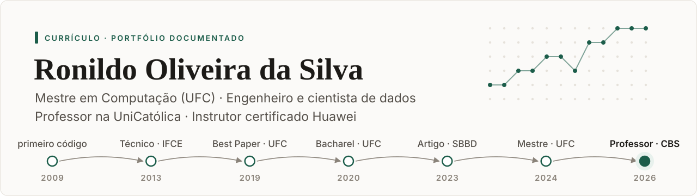
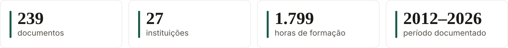

<div align="center">

<picture>
  <source media="(prefers-color-scheme: dark)" srcset="assets/readme/banner-escuro.svg">
  
</picture>

</div>

<p align="center">
  <a href="https://ronildosilva.github.io/Curriculum-Vitae/"><picture><source media="(prefers-color-scheme: dark)" srcset="assets/readme/botoes/portfolio-escuro.svg"></picture></a>
  <a href="https://www.linkedin.com/in/ronildooliveira"><picture><source media="(prefers-color-scheme: dark)" srcset="assets/readme/botoes/linkedin-escuro.svg"></picture></a>
  <a href="http://lattes.cnpq.br/1445392245409691"><picture><source media="(prefers-color-scheme: dark)" srcset="assets/readme/botoes/lattes-escuro.svg"></picture></a>
  <a href="https://orcid.org/0009-0008-4629-117X"><picture><source media="(prefers-color-scheme: dark)" srcset="assets/readme/botoes/orcid-escuro.svg"></picture></a>
  <a href="https://doi.org/10.5281/zenodo.23516272"><picture><source media="(prefers-color-scheme: dark)" srcset="assets/readme/botoes/zenodo-escuro.svg"></picture></a>
</p>

Depois que consegui fazer uma aplicação escrever meu nome na tela, em Turbo Pascal 6.0,
soube que era isso que eu queria estudar. Vieram o técnico em informática no IFCE, a
graduação e o mestrado em Computação na UFC, e anos de monitoria, estágio em
desenvolvimento, projetos de pesquisa e docência. Sigo emendando as formações desde 2009.

Hoje trabalho com aprendizado de máquina aplicado — mineração de processos, visão
computacional e engenharia de dados em nuvem. Este repositório reúne, em um só lugar
e com o documento original anexado, tudo que sustenta esse currículo.

<picture>
  <source media="(prefers-color-scheme: dark)" srcset="assets/readme/numeros-escuro.svg">
  
</picture>

<h2><picture><source media="(prefers-color-scheme: dark)" srcset="assets/readme/secoes/formacao-escuro.svg"></picture></h2>

| | | |
|---|---|---|
| **Pós-graduação em Engenharia de Software em IA Aplicada** | Centro Universitário Anhanguera (UNIPDS) | 480 h · 100% online · 2026–2027, em andamento |
| **Mestre em Computação** | Universidade Federal do Ceará | [diploma](portfolio/01-formacao-academica/diploma-mestrado-computacao-ufc.pdf) · 2024 |
| **Bacharel em Ciência da Computação** | Universidade Federal do Ceará | [diploma](portfolio/01-formacao-academica/diploma-bacharelado-ciencia-da-computacao-ufc.pdf) · 2020 |
| **Técnico em Informática** | IFCE | 2013 |

Aprovado no [POSCOMP 2019](portfolio/01-formacao-academica/poscomp-exame-nacional-pos-graduacao-em-computacao.pdf) (SBC)
e no processo seletivo de doutorado em Ciência da Computação pela UFC.

<h2><picture><source media="(prefers-color-scheme: dark)" srcset="assets/readme/secoes/certificacoes-escuro.svg"></picture></h2>

| Certificação | Emissor | Ano |
|---|---|---|
| [HCIA-AI V3 — Huawei Certified ICT Associate, Artificial Intelligence](portfolio/03-certificacoes/hcia-ai-v3-huawei-certified-ict-associate-artificial-intelligence.pdf) | Huawei | 2024 |
| [Huawei Certified Academy Instructor](portfolio/03-certificacoes/huawei-certified-academy-instructor.pdf) | Huawei | 2021 |
| [Huawei Certified ICT Associate — 5G](portfolio/03-certificacoes/huawei-certified-ict-associate-5g.pdf) | Huawei | 2020 |
| [Google Cloud Arcade Facilitator](portfolio/03-certificacoes/google-cloud-arcade-facilitator-gcaf25c1.pdf) | Google Cloud | 2025 |
| [Scrum Foundation Professional Certificate](portfolio/03-certificacoes/scrum-foundation-professional-certificate-sfpc.pdf) | CertiProf | 2019 |
| [DevOps Essentials Professional Certificate](portfolio/03-certificacoes/devops-essentials-professional-certificate-depc-pt.pdf) | CertiProf | 2019 |

Mais os preparatórios oficiais para as provas **Google Cloud Associate Cloud Engineer**
e **Professional Data Engineer** — [ver todas](portfolio/03-certificacoes/).

<h2><picture><source media="(prefers-color-scheme: dark)" srcset="assets/readme/secoes/producao-cientifica-escuro.svg"></picture></h2>

- **Da Complexidade do Processo à Trajetória de Presença: Sinais de Mineração de Processos Educacionais para um Radar de Evasão no Ensino Superior** — trabalho apresentado no **21º Congresso Brasileiro de Sistemas** (Uni-FACEF, 2026), com os orientandos Francisca Bianca da Silva e Isaac da Silva Viana · [certificado de apresentação](portfolio/04-producao-cientifica/certificado-apresentacao-cbs-2026-radar-de-evasao.pdf) · [código e dados de reprodução (Zenodo, DOI 10.5281/zenodo.23516272)](https://doi.org/10.5281/zenodo.23516272)
- **[Predição de Tempo Restante para Conclusão de Processos de Negócio Utilizando Aprendizado Profundo](portfolio/04-producao-cientifica/predicao-de-tempo-restante-em-processos-de-negocio-sbbd-2023.pdf)** — artigo completo, **SBBD 2023** (38º Simpósio Brasileiro de Bancos de Dados) · [certificado de apresentação](portfolio/04-producao-cientifica/certificado-apresentacao-sbbd-2023.pdf)
- **[Análise de Extratores e Matchers de Minúcias em Impressões Digitais](portfolio/04-producao-cientifica/analise-de-extratores-e-matchers-de-minucias-em-impressoes-digitais.pdf)** — 🏆 **Best Paper**, [Encontros Universitários UFC 2019](portfolio/04-producao-cientifica/encontros-universitarios-2019-best-paper.pdf)
- [Proposta de Melhoria na Detecção de Minúcias em Impressões Digitais Escaneadas pelo NBIS](portfolio/04-producao-cientifica/proposta-de-melhoria-na-deteccao-de-minucias-pelo-nbis.pdf) — 2018
- [Reconhecimento de Textos Manuscritos Através de Técnicas de Aprendizado de Máquina](portfolio/04-producao-cientifica/reconhecimento-de-textos-manuscritos-com-aprendizado-de-maquina.pdf) — 2017

<h2><picture><source media="(prefers-color-scheme: dark)" srcset="assets/readme/secoes/docencia-escuro.svg"></picture></h2>

Professor de ensino superior no **Centro Universitário Católica de Quixadá (UniCatólica)** desde 2026, nas disciplinas de desenvolvimento web, redes, arquitetura de computadores e IA. Orienta TCCs e estágio supervisionado e coordena o projeto de pesquisa **GPISE / Radar Acadêmico**, sobre evasão no ensino superior, que gerou com dois orientandos o artigo do [21º CBS](portfolio/04-producao-cientifica/certificado-apresentacao-cbs-2026-radar-de-evasao.pdf) e o [pacote aberto de código e dados](https://doi.org/10.5281/zenodo.23516272).

Instrutor certificado da **Huawei ICT Academy**, formando alunos para a certificação
HCIA-AI sob o [acordo de parceria UFC / ASTEF / Huawei](portfolio/05-docencia/plano-de-trabalho-acordo-ufc-astef-huawei.pdf).

Monitor na UFC — Campus Quixadá em [Fundamentos de Programação](portfolio/05-docencia/monitoria-fup.jpg),
[Programação Orientada a Objetos](portfolio/05-docencia/monitoria-poo.jpg) e
[Estrutura de Dados](portfolio/05-docencia/programa-de-monitoria-de-estrutura-de-dados-e-estrutura-de-dados-avancada.pdf),
além de [estágio em docência](portfolio/05-docencia/relatorio-estagio-em-docencia.pdf) na pós-graduação.

<h2><picture><source media="(prefers-color-scheme: dark)" srcset="assets/readme/secoes/pesquisa-escuro.svg"></picture></h2>

Bolsista em projetos de IA aplicada à segurança pública e à saúde:

- [Inteligência Científica e Tecnológica na Segurança Pública](portfolio/06-projetos-pesquisa/projeto-inteligencia-cientifica-e-tecnologica-na-seguranca-publica.pdf) — UFC / FUNCAP
- [Portfólio de Projetos SENASP](portfolio/06-projetos-pesquisa/portfolio-de-projetos-senasp-2019.pdf) — Secretaria Nacional de Segurança Pública
- [Modelos de Machine Learning para Caracterização de Biossinais](portfolio/06-projetos-pesquisa/projeto-de-pesquisa-machine-learning-para-biossinais.pdf)
- [Análise de Texto em Redes Sociais usando CLS, MTL e AutoML](portfolio/06-projetos-pesquisa/projeto-de-pesquisa-analise-de-texto-em-redes-sociais-usando-cls-mtl-automl.pdf)

<h2><picture><source media="(prefers-color-scheme: dark)" srcset="assets/readme/secoes/idiomas-escuro.svg"></picture></h2>

**Inglês — C2** ([EF English Live, Upper Advanced](portfolio/02-idiomas/ef-level-16-upper-advanced-cefr-level-c2.pdf)),
com [TOEFL ITP](portfolio/02-idiomas/toefl-itp-declaracao-isf.pdf) pelo programa Idiomas sem Fronteiras
e formação continuada na Berlitz. [Ver os 23 certificados](portfolio/02-idiomas/).

<h2><picture><source media="(prefers-color-scheme: dark)" srcset="assets/readme/secoes/formacao-continuada-escuro.svg"></picture></h2>

**146 cursos** concluídos — 77 no Coursera (especializações em Machine Learning,
Arquitetura Google Cloud e Algoritmos/Stanford), 25 na Udemy, 10 na Alura, além de
Microsoft, segurança da informação e cursos de extensão.
[Ver todos](portfolio/08-cursos/).

<h2><picture><source media="(prefers-color-scheme: dark)" srcset="assets/readme/secoes/curriculo-escuro.svg"></picture></h2>

[Currículo em PDF](portfolio/09-curriculo/curriculo-ronildo-silva-en.pdf) ·
[Currículo Lattes](http://lattes.cnpq.br/1445392245409691)

---

<details>
<summary><b>Como este repositório funciona</b> — organização, catálogo e privacidade</summary>

<br>

### Organização

```
portfolio/
├── 01-formacao-academica/    diplomas, qualificação, POSCOMP, seleção de doutorado
├── 02-idiomas/               EF English Live, Berlitz, TOEFL, ISF, My English Online
├── 03-certificacoes/         Huawei HCIA-AI, Google Cloud, CertiProf
├── 04-producao-cientifica/   artigos, resumos e trabalhos apresentados
├── 05-docencia/              monitorias, estágio em docência, instrutor Huawei
├── 06-projetos-pesquisa/     projetos de pesquisa e desenvolvimento
├── 07-eventos-e-premios/     FLISOL, WTISC, FEMECI, OBMEP, hackathons
├── 08-cursos/                cursos livres, por plataforma
└── 09-curriculo/             currículos em PDF (o Lattes fica no link público)

data/catalogo.json            metadados de todos os documentos (fonte do site)
index.html                    o site — abre por duplo clique e no GitHub Pages
scripts/gerar-site.py         embute o catálogo no index.html e chama gerar-identidade.py
scripts/gerar-identidade.py   banner e faixa de números do README (assets/readme/)
```

### O catálogo

`data/catalogo.json` é a fonte de verdade. Cada item traz `arquivo`, `titulo`,
`categoria`, `plataforma`, `emissor`, `data`, `horas` e `credencial`.

Para adicionar um documento:

1. Coloque o arquivo na pasta da categoria, com nome em `minusculas-com-hifens`.
2. Acrescente a entrada em `data/catalogo.json`.
3. Rode `python3 scripts/gerar-site.py`.

O passo 3 copia o catálogo para dentro do `index.html`. É o que faz a página abrir
por duplo clique: em `file://` o navegador bloqueia a leitura de arquivos externos,
então o catálogo precisa viajar junto com o HTML. Sem esse passo, o site continua
funcionando no GitHub Pages, mas não localmente.

### Logos das instituições

Cada card mostra a logo do emissor quando ela existe em `assets/logos/`, e um
monograma colorido quando não existe. Para acrescentar uma logo, salve um **PNG de
fundo transparente** com o nome do emissor em minúsculas e hifens — "EF English Live"
vira `ef-english-live.png` — e rode `python3 scripts/gerar-site.py`. O script lista
quais emissores ainda estão sem arquivo e com que nome esperá-los.

Prefira o **símbolo** da marca ao logotipo com o nome por extenso: o selo tem 22px e
o texto vira borrão nesse tamanho. As logos são exibidas sobre um ladrilho branco nos
dois temas, porque várias têm partes pretas que sumiriam no tema escuro.

Existe também uma pasta `legacy/` local, fora do controle de versão: versão anterior
deste repositório, artigos de terceiros usados como referência e material de estudo.
Nada ali é credencial nem é referenciado pelo catálogo.

### Privacidade

Este repositório é público, então documentos com dados pessoais sensíveis não entram
aqui — RG, CPF, título de eleitor, CTPS, comprovante de residência, IRPF, notas fiscais,
exames e laudos médicos, contratos e rescisões ficam em arquivo privado separado.

Os diplomas são publicados em **versão tarjada**: RG, data de nascimento, filiação e
assinaturas manuscritas foram cobertos. Os originais íntegros não estão aqui.

O `.gitignore` traz uma barreira contra commitar esse tipo de arquivo por engano, mas
ela não substitui conferir o documento antes de adicioná-lo.

</details>

<br>

<picture><source media="(prefers-color-scheme: dark)" srcset="assets/readme/rodape-escuro.svg"></picture>
